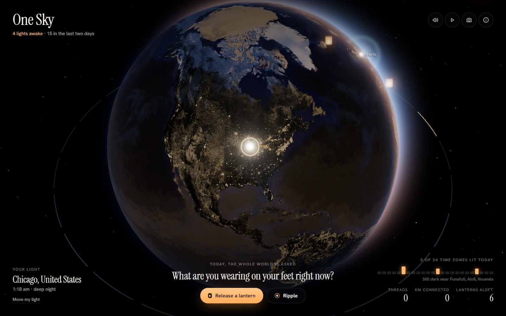
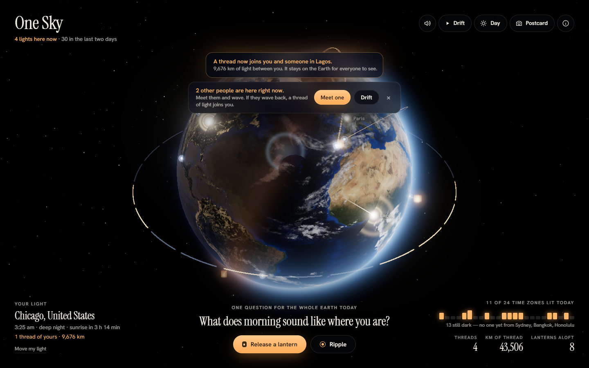

# One Sky

**Everyone here right now is a light on the Earth.**

Live: **https://jacobnaumann.github.io/one-sky/**



One Sky is the Earth as it is this minute — the sun where the sun is, night where night is, city lights
on the dark side — and every person who has the page open is a point of light where they are.
You are not reading a feed. You are looking at the planet and seeing who else is awake on it.

## What you can do

| | |
|---|---|
| **See who is awake** | Each light is a real person on the page right now. Tap one: their city, their local time, what their sky is doing, how far they are from you. Soft rings show where other people are looking. |
| **Wave** | An arc of light travels the great circle to them. They hear it arrive. If they wave back, a **thread** stays on the globe between you, and its length joins the world's total of kilometres connected. |
| **Ripple** | Send a ring of light around the whole planet from where you are. Everyone sees and hears it. |
| **Release a lantern** | One question a day, the same for the whole world. Your answer (140 characters) floats over your city for 48 hours. Anyone can read it, warm it, and — where the browser has a built-in translator — read it in their own language. |
| **Close the ring** | Around the Earth is a ring of 24 segments, one per time zone. Each lights when someone from that zone arrives. The world has until midnight UTC to light them all. |
| **Leave a wave** | Faint blue lights are echoes of people who were here in the last two days. Leave one a wave; they receive it the next time they arrive. |
| **Drift** | Press Drift and the Earth carries you from lantern to lantern, each one set large across the sky. |
| **Watch a day pass** | Sweep the sun through the next 24 hours and watch night cross the planet. |
| **Tap anywhere** | Any spot on Earth tells you its local time and sky. The feed tells you where the sun is rising and where night is falling, right now. |
| **Postcard** | Save the Earth as you see it, with the day's numbers. |



## Honest by design

- **Nobody is simulated.** Every bright light is a live browser. Faint blue lights are *echoes* — real people
  who were here in the last two days — and say so. A handful of welcome lanterns are signed "From One Sky".
- **No account, no name, no location permission.** Your light is placed near the main city of your
  time zone, read from your device's clock. You can move it to any of 418 places. There is no IP lookup.
- **The only free text is lanterns**, filtered on the device and again in the database, rate-limited, and
  reportable (three reports hide one).

## How it is built

- **Front end:** Vite + TypeScript + Three.js, no UI framework. Custom GLSL for the day/night blend from
  the real solar position, city lights, clouds, atmosphere, ripples, wave arcs, threads and the ring.
  Generative sound in raw Web Audio (everything is in D major pentatonic, each person's pitch set by their
  longitude, so any crowd is in tune). Fonts are self-hosted; there are no third-party requests at runtime
  except to the project's own Supabase.
- **Back end:** Supabase. Anonymous sign-in for a stable id; a Realtime channel for presence, gaze, waves and
  ripples; Postgres for lanterns, threads, echoes and the ring. Row-level security on every table, column-level
  grants so user ids are never readable through the API, and every write goes through a rate-limited function
  that validates the place against a server-side table.
- **Hosting:** GitHub Pages, built by GitHub Actions on every push to `main`.

Project memory — architecture, operations, decisions and a dated log — lives in [`vault/`](vault/index.md).

## Run it

```bash
npm install
npm run dev        # http://localhost:5173
npm test           # unit tests
npm run e2e        # multi-visitor browser tests (needs the dev server running)
```

`ONE_SKY_URL=https://jacobnaumann.github.io/one-sky/ npm run e2e` runs the same tests against production.

## Credits

Earth imagery: NASA Blue Marble and Black Marble (public domain), via the three.js and three-globe example
assets. Type: Instrument Serif and Hanken Grotesk (SIL Open Font License). Time-zone places: IANA tz database.

Built in one night by Claude (Anthropic) for Jacob.
